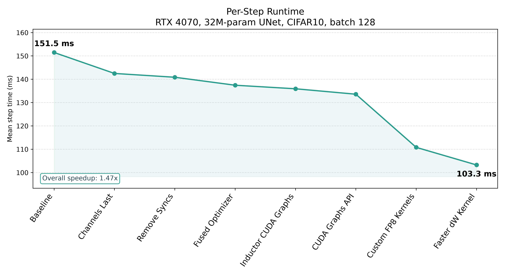

# Profiled DDPM

Companion code for [Profiling and Optimizing a CIFAR10 DDPM Training Loop](https://benfattori.com/profiled-ddpm/).



## Installation

Requires `uv`:

```bash
git clone https://github.com/fattorib/diffusion-profiled.git && cd diffusion-profiled
uv sync
wandb login
```

## Training

Requires an NVIDIA GPU, only tested on RTX-4070. The fastest configuration uses the FP8 Triton
kernels, so it needs an Ada/Hopper card (sm89+). This will train the fastest DDPM configuration
for 100K steps:

```bash
uv run train.py
```

## Profiling

There is one script to generate a tensorboard profile with CUDA Graph capture and another without:

```bash
uv run extra/profile_cuda_graph.py
uv run extra/profile_no_cuda_graph.py
```

Set `do_tb_profile = True` in the script to write a trace to `./log/speedy`, then view it:
```bash
uv run tensorboard --logdir=./log/speedy
```

## Citations
```
@article{DBLP:journals/corr/abs-2006-11239,
  author       = {Jonathan Ho and
                  Ajay Jain and
                  Pieter Abbeel},
  title        = {Denoising Diffusion Probabilistic Models},
  journal      = {CoRR},
  volume       = {abs/2006.11239},
  year         = {2020},
  url          = {https://doi.org/10.48550/arXiv.2006.11239},
  doi          = {10.48550/ARXIV.2006.11239},
  eprinttype   = {arXiv},
  eprint       = {2006.11239},
  timestamp    = {Thu, 01 Oct 2026 10:56:20 +0200},
  biburl       = {https://dblp.org/rec/journals/corr/abs-2006-11239.bib},
  bibsource    = {dblp computer science bibliography, https://dblp.org}
}
```

```
@article{DBLP:journals/corr/abs-2102-09672,
  author       = {Alex Nichol and
                  Prafulla Dhariwal},
  title        = {Improved Denoising Diffusion Probabilistic Models},
  journal      = {CoRR},
  volume       = {abs/2102.09672},
  year         = {2021},
  url          = {https://doi.org/10.48550/arXiv.2102.09672},
  doi          = {10.48550/ARXIV.2102.09672},
  eprinttype   = {arXiv},
  eprint       = {2102.09672},
  timestamp    = {Thu, 01 Oct 2026 10:11:27 +0200},
  biburl       = {https://dblp.org/rec/journals/corr/abs-2102-09672.bib},
  bibsource    = {dblp computer science bibliography, https://dblp.org}
}
```

```
@misc{micikevicius2022fp8formatsdeeplearning,
      title={FP8 Formats for Deep Learning}, 
      author={Paulius Micikevicius and Dusan Stosic and Neil Burgess and Marius Cornea and Pradeep Dubey and Richard Grisenthwaite and Sangwon Ha and Alexander Heinecke and Patrick Judd and John Kamalu and Naveen Mellempudi and Stuart Oberman and Mohammad Shoeybi and Michael Siu and Hao Wu},
      year={2022},
      eprint={2209.05433},
      archivePrefix={arXiv},
      primaryClass={cs.LG},
      url={https://arxiv.org/abs/2209.05433}, 
}
```
